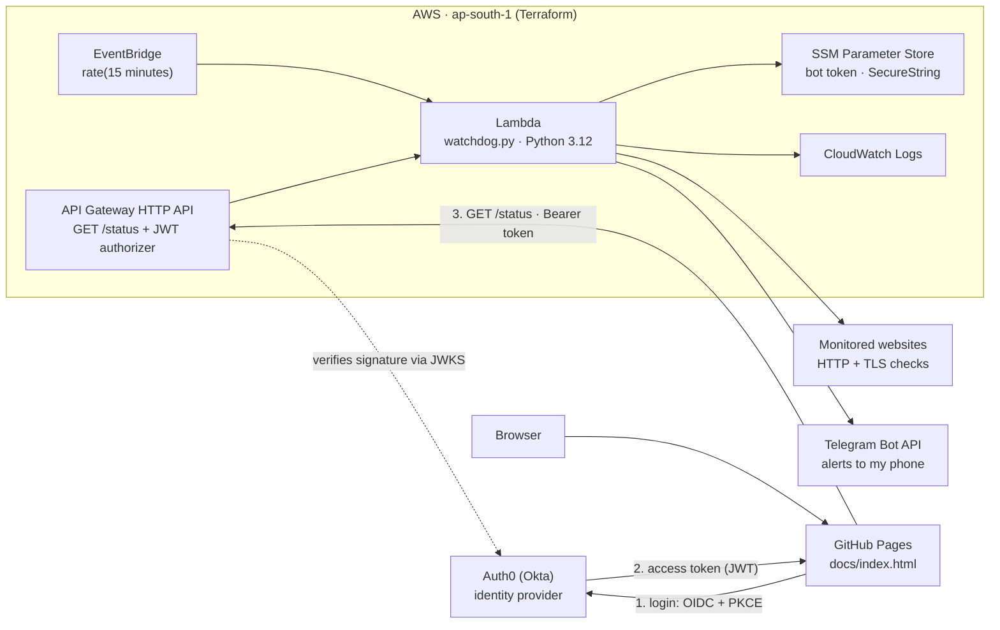
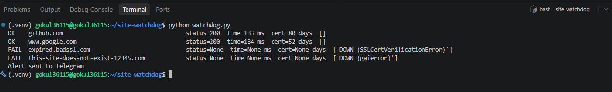
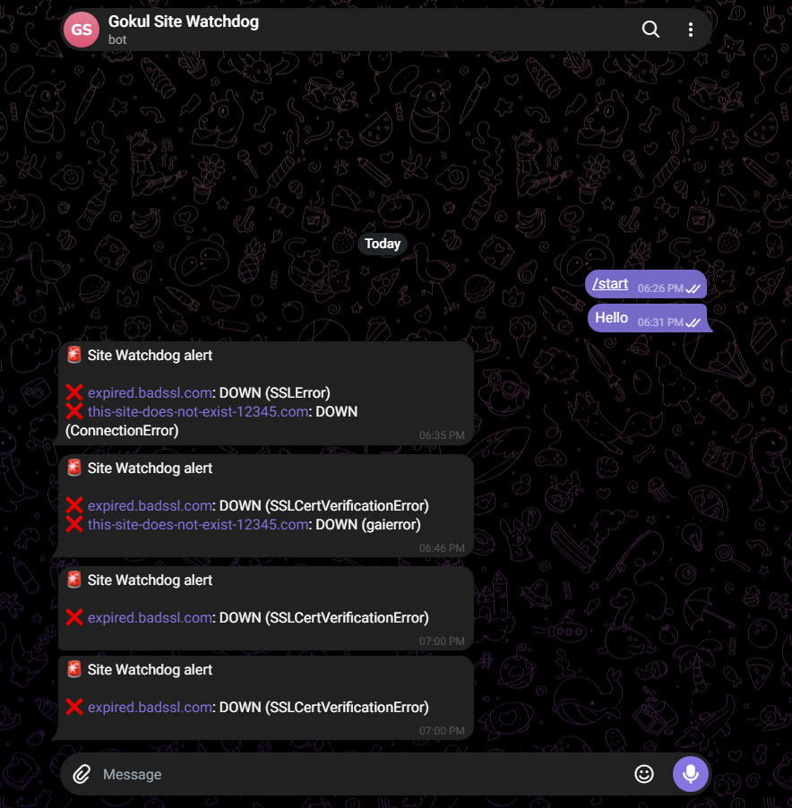
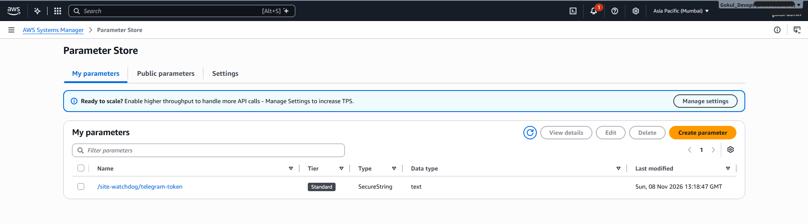
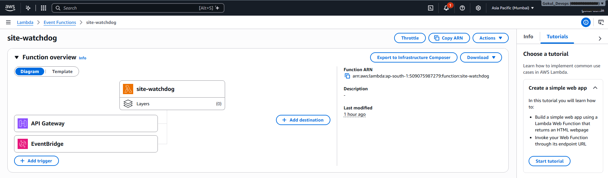
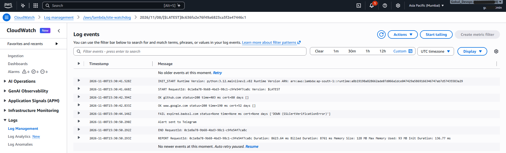
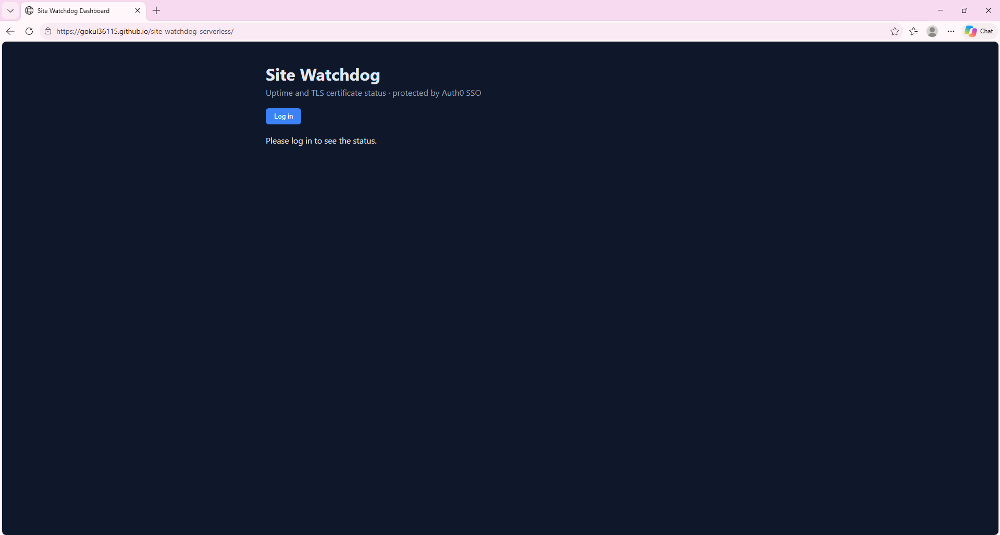
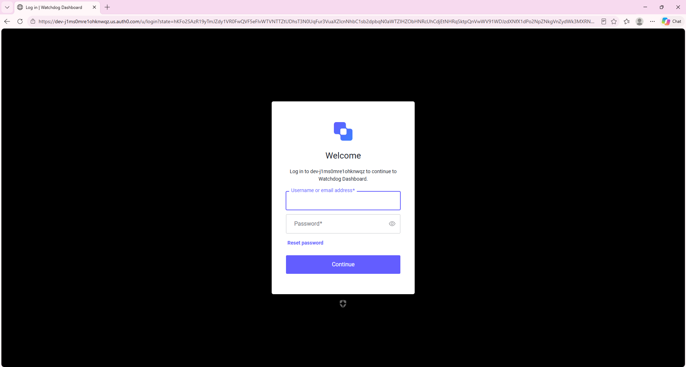
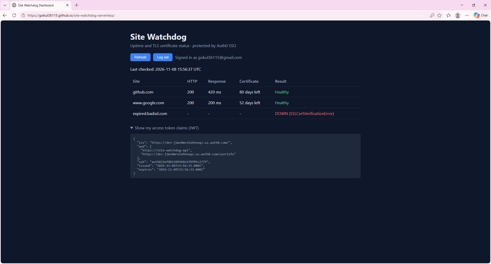
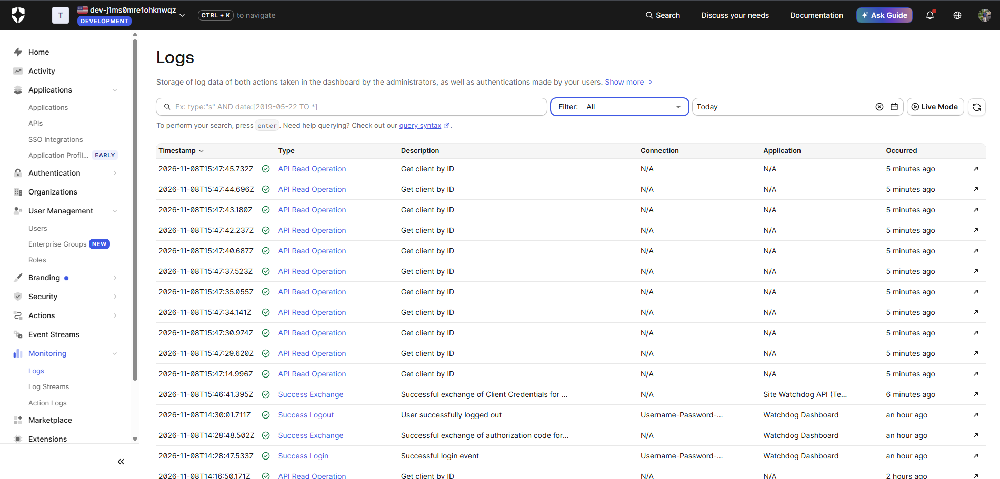

# Site Watchdog: Serverless Uptime & TLS Monitor with SSO Dashboard

**A serverless monitor on AWS that checks websites every 15 minutes for uptime, response time and SSL/TLS certificate expiry, sends Telegram alerts when something breaks, and serves a live dashboard protected by Auth0 (Okta) single sign-on, all provisioned with Terraform.**

**Live dashboard:** https://gokul36115.github.io/site-watchdog-serverless/ (login required: only users created in the identity provider can see the data)

---

## Contents
- [What it does](#what-it-does)
- [Architecture](#architecture)
- [Tech stack](#tech-stack)
- [How it works](#how-it-works)
- [Security design](#security-design)
- [Project structure](#project-structure)
- [Deploy it yourself](#deploy-it-yourself)
- [Results](#results)
- [Cost](#cost)
- [Design decisions](#design-decisions)
- [Problems faced and fixes](#problems-faced-and-fixes)
- [Roadmap](#roadmap)

---

## What it does

| Check | Problem when |
|---|---|
| Is the site up? | No answer (DNS failure, TLS failure, timeout) or HTTP status not 200 |
| Is it fast? | Response slower than 3 seconds |
| Is the certificate healthy? | Certificate invalid or expiring in under 14 days |

- **Every 15 minutes** an EventBridge schedule runs the Lambda. If any site has a problem, **one Telegram message** lists all of them.
- **On demand**, the dashboard shows the same checks live, but only after an **Auth0 login**. API Gateway verifies the JWT before the Lambda ever runs.

---

## Architecture



Three places, three jobs:

| Where | What lives there |
|---|---|
| **GitHub Pages** | The dashboard: one static HTML file, no secrets |
| **Auth0** | Login page, the user, token signing |
| **AWS** | Lambda (the checks), API Gateway (the guarded door), EventBridge (the schedule), SSM (the secret), CloudWatch (the logs) |

---

## Tech stack

| Area | Tools |
|---|---|
| Code | Python 3.12, standard library only (`urllib`, `ssl`, `socket`) + `boto3` (built into Lambda) |
| Compute | AWS Lambda (128 MB, 60 s timeout) |
| Scheduling | Amazon EventBridge rule, `rate(15 minutes)` |
| API | API Gateway HTTP API with a **JWT authorizer**, CORS locked to the dashboard origin, throttling |
| Identity | **Auth0 (Okta)**: OIDC, Authorization Code flow with **PKCE**, RS256-signed access tokens |
| Secrets | SSM Parameter Store `SecureString` (KMS-encrypted) |
| Observability | CloudWatch Logs (7-day retention) |
| Alerts | Telegram Bot API |
| Frontend | Static HTML + Auth0 SPA SDK, hosted on GitHub Pages |
| Infrastructure as Code | Terraform (AWS + archive providers), 13 resources |

---

## How it works

### Path 1: Scheduled check and alert
1. EventBridge fires every 15 minutes and invokes the Lambda.
2. For each site, `check_http()` opens the URL (timing the response) and `cert_days_left()` does a TLS handshake on port 443 and reads the certificate's `notAfter` date.
3. Problems are collected. If there are any, the function reads the Telegram bot token from **SSM Parameter Store** (decrypted at run time) and sends one message.
4. Every result line goes to CloudWatch Logs.

### Path 2: Dashboard with SSO
1. The browser loads `docs/index.html` from GitHub Pages and shows a **Log in** button.
2. **Log in** redirects to Auth0's hosted login page (Universal Login). The password is only ever typed on Auth0's domain.
3. Auth0 redirects back with a one-time code. The Auth0 SDK exchanges it for tokens using **PKCE** (no client secret in the browser).
4. The page calls `GET /status` with `Authorization: Bearer <access token>`.
5. The API Gateway **JWT authorizer** checks the token's signature against Auth0's public keys (JWKS), the issuer (`iss`), the audience (`aud = https://site-watchdog-api`) and the expiry (`exp`). Any failure means **401**, and the Lambda never runs.
6. Valid token: the Lambda runs the checks live and returns JSON. It logs the caller's user ID (`sub`) for an audit trail and does **not** send Telegram for dashboard calls.

The same function serves both paths: API Gateway events contain `requestContext.http`, scheduled events don't.

---

## Security design

- **Least-privilege IAM:** the Lambda role can only write to its own log group and read **one** SSM parameter. Nothing else.
- **Secret never in code or Terraform state:** the bot token was put into SSM by hand (`put-parameter --type SecureString`); Terraform only knows the parameter's *name*.
- **Token validation at the edge:** API Gateway's JWT authorizer rejects bad tokens before any code runs. Verified with `curl` (no token) → `HTTP/2 401 {"message":"Unauthorized"}`.
- **Audience-bound tokens:** only tokens issued for `https://site-watchdog-api` are accepted.
- **Locked-down identity provider:**
  - public sign-ups disabled: only admin-created users can log in
  - all social logins (Google, GitHub, Facebook, Microsoft) switched off for the app
  - machine-to-machine (client credentials) access to the API blocked; only user logins can get tokens
  - the app is explicitly authorized for the one API it needs
- **No embedded login:** cross-origin authentication is off; login happens only on Auth0's hosted page.
- **Browser hardening:** CORS allows only `https://gokul36115.github.io`; tokens are kept in memory (not localStorage); results are rendered with `textContent`, never `innerHTML`.
- **Abuse limits:** API throttling (burst 5, rate 2 requests/s).

---

## Project structure

```
site-watchdog-serverless/
├── watchdog.py                  # the checker: HTTP + TLS checks, Telegram alerts, Lambda handler
├── terraform/
│   ├── providers.tf             # AWS + archive providers, region, default tags
│   ├── variables.tf             # sites, chat ID, SSM name, schedule, Auth0 settings
│   ├── main.tf                  # zip, log group, IAM role/policy, Lambda, EventBridge schedule
│   ├── api.tf                   # HTTP API, JWT authorizer, route, stage, permission
│   ├── outputs.tf               # function name, log group, status URL
│   └── terraform.tfvars.example # copy to terraform.tfvars and fill in
├── docs/
│   ├── index.html               # the SSO dashboard (served by GitHub Pages)
│   ├── errors.md                # problems faced and how I fixed them
│   └── screenshots/
└── .gitignore                   # venv, Terraform state, tfvars, build output
```

---

## Deploy it yourself

**Prerequisites:** AWS CLI configured (an IAM user, not root), Terraform ≥ 1.5, Python 3.12, a Telegram bot (from @BotFather) and an Auth0 tenant.

**1. Run locally**
```bash
python3 -m venv .venv && source .venv/bin/activate
 export TELEGRAM_TOKEN="<bot token>"          # leading space keeps it out of shell history
export TELEGRAM_CHAT_ID="<your chat id>"
export SITES="https://github.com,https://expired.badssl.com"
python watchdog.py
```

**2. Store the bot token in AWS (once)**
```bash
 aws ssm put-parameter --name "/site-watchdog/telegram-token" --type SecureString --value "<bot token>" --region ap-south-1
```

**3. Auth0 setup**
- **API:** identifier `https://site-watchdog-api`, RS256; client (machine-to-machine) access: none.
- **Application:** *Single Page Application*.
  - Callback and Logout URL: `https://<user>.github.io/site-watchdog-serverless/`
  - Web Origin: `https://<user>.github.io`
  - API Access: authorize the API for user-delegated access.
- **Connections:** only Username-Password-Authentication. Disable sign-ups and create the user by hand.

**4. Deploy with Terraform**
```bash
cd terraform
cp terraform.tfvars.example terraform.tfvars    # fill in your values
terraform init
terraform apply
terraform output status_url
```

**5. Dashboard**
- Put your Auth0 domain, Client ID and `status_url` into `docs/index.html`.
- Push, then enable **Settings → Pages → Deploy from a branch → main → /docs**.

**6. Tear down**
```bash
terraform destroy
aws ssm delete-parameter --name "/site-watchdog/telegram-token" --region ap-south-1
```

---

## Results

### Checker running locally
`expired.badssl.com` fails certificate verification and a non-existent domain fails DNS (`gaierror`), exactly the failures it should catch.



### Telegram alerts
One message per run, listing every problem.



### Secret stored encrypted


### Lambda with both triggers
EventBridge (schedule) and API Gateway (dashboard) invoke the same function.



### Scheduled run in CloudWatch
Checks, alert, then the `REPORT` line: about 8.6 s duration and 93 MB of 128 MB memory used.



### No token, no data
```text
$ curl -i https://<api-id>.execute-api.ap-south-1.amazonaws.com/status
HTTP/2 401
www-authenticate: Bearer
{"message":"Unauthorized"}
```

### SSO login flow
| Not logged in | Auth0 hosted login (note the address bar) |
|---|---|
|  |  |

### Dashboard after login
Live results plus the decoded access-token claims: `iss` (Auth0 tenant), `aud` (`https://site-watchdog-api`), `sub` (the user), issue and expiry times.



### Identity-provider audit trail
Auth0 logs every login, code exchange and logout.



---

## Cost

| Service | Usage | Cost |
|---|---|---|
| Lambda | about 2,900 scheduled runs/month × about 9 s × 128 MB | within the always-free tier |
| EventBridge scheduled rule | 1 rule | free |
| API Gateway HTTP API | a few calls per day | negligible |
| SSM Parameter Store | 1 standard parameter | free |
| CloudWatch Logs | a few KB per run, 7-day retention | negligible |
| GitHub Pages, Auth0 free plan, Telegram | | free |

---

## Design decisions

| Chose | Instead of | Why |
|---|---|---|
| Lambda + EventBridge | EC2 or a cron server | Nothing to patch, pay per run, the schedule is just config |
| Python standard library only | `requests` + a packaged zip | The whole Lambda is one file; Terraform zips it with `archive_file` |
| SSM SecureString created by hand | a Terraform-managed secret | Keeps the secret out of `terraform.tfstate` |
| API Gateway JWT authorizer | validating tokens in Python | Built-in, no code, rejects requests before the function runs |
| Live checks on demand | storing results in S3/DynamoDB | Fewer resources; the dashboard is always current |
| Auth0 (Okta) | Okta Workforce Integrator plan | The Okta free plan needs a business email; Auth0 is Okta's customer-identity product with the same OIDC/JWT standards |
| GitHub Pages | S3 + CloudFront | Free HTTPS hosting for one static file, no extra AWS resources |
| Telegram | email or SMS | Free, instant on the phone. In a company I'd route the same alert to Slack, Teams or PagerDuty, and only `send_telegram()` would change |

**Known limits (and what I'd add next):**
- A site that stays down triggers a reminder every 15 minutes. De-duplication needs state (e.g. a small DynamoDB table holding the last status).
- Checks run from one region only. Multi-region checks would separate "site down" from "network path down".
- The access token lifetime is Auth0's default (24 h); shortening it to 1 h is a one-setting change.

---

## Problems faced and fixes
The real issues from building this (Telegram API 404, Lambda missing `requests`, the Okta free plan rejecting Gmail, old test users in the identity provider, the GitHub Pages first-deploy 404, and an auto-created machine-to-machine test app that could get API tokens without a user login) are documented with root cause and fix in **[docs/errors.md](docs/errors.md)**.

---

## Roadmap
- [ ] Alert de-duplication with DynamoDB (notify on state change only)
- [ ] Route alerts through SNS to email or Slack as well as Telegram
- [ ] GitHub Actions: lint, `terraform validate` and `plan` on pull requests
- [ ] Group- or role-based access on the dashboard (RBAC claims checked by the authorizer)

---

## Author
**Gokul N** · Middleware Engineer (IBM WebSphere, Liberty, IHS, Okta SSO, SSL/TLS) · AWS · DevOps · SRE
GitHub: [Gokul36115](https://github.com/Gokul36115)